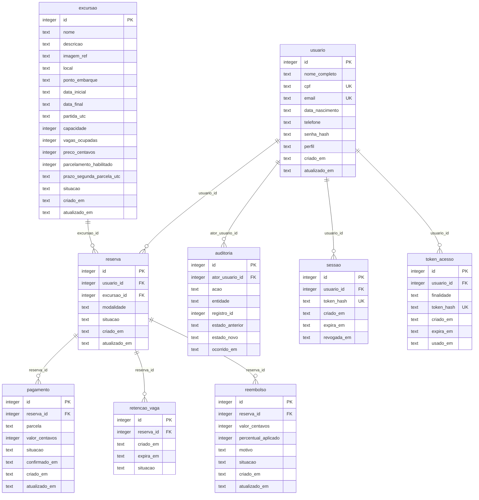

# Auditoria de sincronia: TCC (Google Docs) × projeto — 2026-11-20

Escopo: Google Docs "VERSÃO BASE DO TCC" (revisão `AHj4eMQd0z6vUApFjyR4F_CUXIR5w420Td8o86gjtwnOUZlv3pqm2fheaGdoqqnlhjrsoWLeJUVlU6UNPyFZ-S3N0L2vHQM2WDKkguIbDV8`, 842 parágrafos e todas as tabelas, lidos integralmente) contra o repositório no commit `86bbad7` (árvore com `PROXIMOS-PASSOS.md` alterado por você depois desse commit).
Nada foi aplicado no Docs, nada foi alterado fora dos quatro arquivos pedidos e nada foi commitado. O código do piloto não foi lido. Os testes não foram reexecutados nesta auditoria; os números de testes vêm dos registros AGT e do `METRICAS.csv`.
Verificações executadas por script: comparação mecânica dos Apêndices A, B e C com `docs/especificacao/02`, `03` e `04`; esquema real lido de um banco em memória criado pelas migrações; versões lidas de `package.json`, `package-lock.json`, `node -v`, `npm -v`, `sqlite_version()`.

## Resumo

Itens auditados: 69.

| Status | Itens | IDs |
| --- | --- | --- |
| OK | 48 | — |
| DIVERGE | 13 | C1, C4, E5, E9, E10, E14, E17, G8, H3, H4, H5, M2, M3 |
| PERGUNTA AO AUTOR | 6 | A4, B4, D6, E11, F9, M4 |
| FORA DO ALCANCE | 2 | E16, G6 |

Das divergências, 6 são do Docs (C1, C4, E5, E9, E10, E17) e 7 são de arquivos do repositório (E14, G8, H3, H4, H5, M2, M3). As do Docs estão em "Correções sugeridas ao Docs". As do repositório foram corrigidas só quando o arquivo era um dos pedidos (H3, H4); as demais aguardam seu aval.

## Passo 1 — Tabela de auditoria

Status: OK, DIVERGE (o erro é do TCC ou de um documento do repositório, indicado na coluna), FORA DO ALCANCE (depende do código do piloto), PERGUNTA AO AUTOR (decisão que não cabe ao agente).

### 1. Especificação (Capítulo 4, Apêndices A, B e C)

| ID | Trecho do Docs | O que o Docs diz | O que o repositório diz | Status |
| --- | --- | --- | --- | --- |
| A1 | 4.3 e Apêndice A | 42 RF (RF-001 a RF-042); 42 linhas, sem duplicados | `docs/especificacao/02-REQUISITOS-FUNCIONAIS.md`: 42 RF. Título, perfil e AGT idênticos nos 42 itens (comparação por script). `docs/requisitos/RF.md` também tem 42 | OK |
| A2 | 4.4 e Apêndice B | 33 RNF (RNF-001 a RNF-033); sem duplicados | `03-REQUISITOS-NAO-FUNCIONAIS.md`: 33 RNF. Título e categoria idênticos. `docs/requisitos/RNF.md`: 33 | OK |
| A3 | 4.5 e Apêndice C | 44 RN (RN-001 a RN-044); sem duplicados | `04-REGRAS-DE-NEGOCIO.md`: 44 RN. Texto idêntico em 41 itens. `docs/requisitos/RN.md`: 44 | OK |
| A4 | Apêndice C, RN-007, RN-036 e RN-037 | Marcador "[a confirmar]" nas três | A especificação marca "[confirmar a duração]" (RN-007) e "[confirmar]" (RN-036 e RN-037). Os registros dizem que a aprovação da instrução da AGT-005 confirmou a RN-036 e a RN-037 e que a duração do token da RN-007 (30 min) foi decidida na AGT-003. A especificação não foi alterada (regra do CLAUDE.md) | PERGUNTA AO AUTOR (P1) |
| A5 | 4.5.1 a 4.5.5 | Idade mínima 18, CPF e e-mail únicos, retenção temporária, pagamento em 50%, reembolso 100% / 50% / 0 (2 semanas, 1 semana), conclusão 1 dia após a data final, reembolso integral na cancelamento pela organização | RN-001 a RN-004, RN-012 a RN-015, RN-023 a RN-032, RN-040 dizem o mesmo | OK |
| A6 | 4.6 | O fluxo de reserva "inicia o checkout com retenção temporária de vaga" | É o que a especificação prevê (RN-014). O código ainda não faz isso: a retenção é da AGT-008, e a 5.3 e a 6.4 já registram a limitação | OK |
| A7 | Apêndices A, B e C | Listas completas | O repositório tem as três listas completas e iguais às da especificação (`docs/requisitos/RF.md`, `RNF.md`, `RN.md`) | OK |

### 2. Plano das 18 atividades (Seção 3.4 e Apêndice D)

| ID | Trecho do Docs | O que o Docs diz | O que o repositório diz | Status |
| --- | --- | --- | --- | --- |
| B1 | 3.4 | 18 atividades, AGT-001 a AGT-018, nomes e ordem | `07-PLANO-DE-ATIVIDADES.md`: mesmos 18 nomes na mesma ordem | OK |
| B2 | Apêndice D, AGT-008 a AGT-018 | Requisitos associados de cada atividade | Idênticos aos do plano (008: RF-019, 021, 022; RN-014, 015, 021, 040 até 018: RNF-030 a RNF-033) | OK |
| B3 | Apêndice D, AGT-002 a AGT-007 | Requisitos com evidência e em parte | Iguais aos do plano (RF e RNF) | OK |
| B4 | Apêndice D e ficha AGT-001, campo 4 | "RNF-018 a RNF-026 e RNF-029"; RNF-027 e RNF-028 sem evidência | O plano diz "RNF-018 a RNF-029". `docs/matriz-rastreabilidade.md` diz que RNF-027 foi "Prevista na AGT-001; evidência parcial na AGT-003" | PERGUNTA AO AUTOR (P2) |
| B5 | Apêndice D, AGT-005 e AGT-007 | Não listam RN (a AGT-005 cita só RN-036 e RN-037 confirmadas) | O plano associa RN-033, RN-036 a RN-039 (AGT-005) e RN-009, RN-010 (AGT-007). As fichas listam as RN | OK (resumo, não lista completa) |

### 3. Modelo de dados (4.7) e evolução técnica (4.8) contra o esquema e o código

| ID | Trecho do Docs | O que o Docs diz | O que o repositório diz | Status |
| --- | --- | --- | --- | --- |
| C1 | 4.7, 1.º parágrafo | O modelo inclui 7 entidades: Usuário, Excursão, Reserva, Pagamento, Retenção de Vaga, Reembolso e histórico ou auditoria | `06-MODELO-DE-DADOS.md` inclui também "Sessão e token". `server/db/migrations.ts` (versão 1) cria 9 tabelas: `usuario`, `excursao`, `reserva`, `pagamento`, `retencao_vaga`, `reembolso`, `auditoria`, `sessao`, `token_acesso`. A própria 5.3 do Docs cita as "nove entidades" | DIVERGE |
| C2 | 4.7, relações | 1 usuário : N reservas; reserva de um usuário e uma excursão; pagamentos e reembolsos associados à reserva; retenção com criação, expiração e situação | Chaves estrangeiras `reserva.usuario_id`, `reserva.excursao_id`, `pagamento.reserva_id`, `reembolso.reserva_id`, `retencao_vaga.reserva_id`; `retencao_vaga` tem `criado_em`, `expira_em`, `situacao` (ver tabela do Passo 2) | OK |
| C3 | 4.7, último parágrafo | Diagrama em `docs/diagramas/diagramas.md`; esquema físico na AGT-002 e em `docs/banco-de-dados.md` | Os dois arquivos existem. O diagrama é conceitual e não tem `sessao`, `token_acesso` nem a maioria dos campos reais (ver Passo 2) | OK |
| C4 | 4.8 | Só cita a persistência (SQLite por `node:sqlite`, SQL direto) | Correto para a persistência (SQLite 3.54.0, nenhuma biblioteca de acesso). Não cita as demais decisões registradas: Vite, React e `node:http` (AGT-001), scrypt, cookie `sid` e token de 30 min (AGT-003), roteador próprio e CSS puro (AGT-004), centavos e UTC (AGT-005), divisão em parcelas (AGT-007); nem que não houve migração depois da versão 1 | DIVERGE (omissão) |
| C5 | 5.3, AGT-002 | Transações com desfazimento em caso de erro; ocupação acima da capacidade impedida por restrição do banco; auditoria que rejeita campos sensíveis; estratégia de concorrência documentada | `server/db/transaction.ts` (`BEGIN`, `COMMIT`, `ROLLBACK`); `ck_excursao_ocupacao`; `server/db/audit.ts:44`; `docs/banco-de-dados.md` ("Capacidade e concorrência": `BEGIN IMMEDIATE`, `busy_timeout`, `tests/db-concorrencia.test.ts`) | OK |
| C6 | 5.3, AGT-003 a AGT-007 | scrypt N=2^16, r=8, p=2; cookie HttpOnly e SameSite=Strict; token de 30 min; limite de 3 pendentes; lista de 100; preço máximo R$ 100.000,00; capacidade 1 a 1.000; 1.ª parcela pela metade para baixo; uma reserva por passageiro e excursão | `server/auth/config.ts:26`, `server/auth/routes.ts:47`, `server/auth/config.ts:49`, `server/reservas/service.ts:18`, `server/excursoes/publico.ts:11`, `server/excursoes/validation.ts` (`precoMax` 10.000.000 centavos, `capacidadeMax` 1000), `shared/dinheiro.ts:36`, índice `uq_reserva_ativa` | OK |
| C7 | 5.3, AGT-003 a AGT-007 | "sem alterar o esquema" / "nenhuma migração nova" | `migrations.ts` tem uma única migração (versão 1) | OK |

### 4. Tecnologias e versões

| ID | Trecho do Docs | O que o Docs diz | O que o repositório diz | Status |
| --- | --- | --- | --- | --- |
| D1 | Fichas, campo 15 | Node.js v26.13.0, npm 11.20.0 | `node -v` v26.13.0; `npm -v` 11.20.0; registros AGT-001 e AGT-002. `package.json` não declara `engines` | OK |
| D2 | Fichas AGT-001, 004 a 007 | React 19.3.1, Vite 8.3.8, TypeScript 6.0.3, Vitest 5.1.0 | `package.json` e `package-lock.json` (versões exatas iguais) | OK |
| D3 | 5.3, AGT-001 | TypeScript fixado em 6.0.3; a 7.0.2 não era aceita pelo typescript-eslint; `npm audit`: 10 vulnerabilidades moderadas | `AGT-001.md:310`, `:322`, `:325`; `typescript-eslint` 8.72.2 no lockfile | OK |
| D4 | 5.3 e ficha AGT-004 | jsdom 31.0.1, @testing-library/react 16.3.3, @testing-library/dom 10.4.2 | `package.json` e lockfile | OK |
| D5 | Fichas AGT-002 e 5.3 | SQLite 3.54.0 via `node:sqlite` | `select sqlite_version()` = 3.54.0 | OK |
| D6 | Fichas AGT-002 e AGT-003, campo 15 | "Windows 11, Node.js v26.13.0, npm 11.20.0, TypeScript 6.0.3, Vitest 5.1.0" | Os registros AGT-002 e AGT-003 citam também Vite 8.3.8 e ESLint 10.14.0; React e Vite estão no projeto desde a AGT-001. As fichas AGT-004 a AGT-007 listam React e Vite | PERGUNTA AO AUTOR (P4) |
| D7 | Todas as fichas, campo 14 | "Versão da ferramenta Claude Code: [DADO NÃO REGISTRADO]" | Nenhum arquivo do repositório registra a versão da ferramenta; só o modelo (`claude-sonnet-5-5`) | OK |

### 5. Experimento principal, AGT-001 a AGT-007

Comparados: Quadro 2, Seção 5.3, ficha e Apêndice D contra `AGT-00X.md`, `METRICAS.csv`, `git log` e o diário.

| ID | Trecho do Docs | O que o Docs diz | O que o repositório diz | Status |
| --- | --- | --- | --- | --- |
| E1 | Quadro 2, 7 linhas do principal | Classe AP-3; tentativas 2, 1, 1, 1, 1, 1, 1; testes 13/15, 57, 100, 140, 238, 277, 326 (novos: 42, 43, 40, 98, 39, 49); intervenção "Sim"; commits | `METRICAS.csv` e as seções de resultados e de classificação de cada `AGT-00X.md`: idênticos | OK |
| E2 | Quadro 2, AGT-001, testes | "13 (T1) e 15 (T2)" | `METRICAS.csv` guarda uma linha só, com 15. O 13 (T1) está em `AGT-001.md:274` | OK (a planilha não separa as tentativas) |
| E3 | 5.3 e fichas, durações | AGT-001: T1 3 min 13 s, T2 8 min 8 s (≈ 3 min 18 s sem pausas); AGT-002 ≈ 4,2 min; AGT-003 ≈ 6 min; AGT-004 ≈ 6,5 min; AGT-005 ≈ 13,5 min; AGT-006 ≈ 7 min; AGT-007 ≈ 5,3 min, com os horários de início e fim | `AGT-00X.md` (seção de execução) e `METRICAS.csv` (11,35; 4,18; 6,00; 6,50; 13,50; 7,00; 5,30): mesmos horários e valores | OK |
| E4 | 5.3, aprovação das instruções | 11/11 (AGT-001); 13/11 (AGT-002); 13/11 22:40 (003), 23:24 (004), 23:47 (005); 19/11 22:42 (006), 23:34 (007) | AGT-001 linha 3; `AGT-003.md:6` (22:40:09); `AGT-004.md:184` (23:24); `AGT-005.md:208` (23:47:25); `AGT-006.md:182` (22:42:34); `AGT-007.md:203` (23:34:09) | OK |
| E5 | Fichas, campo 6 | AGT-003: "19 critérios… todos marcados" | `AGT-003.md` Seção 4: 20 critérios, 20 marcados. A ficha do repositório (`docs/fichas-agt/principal/AGT-003.md:13`) também diz 19 | DIVERGE |
| E6 | Fichas, campo 6 | AGT-001: 15 critérios, 12 marcados e 3 a decidir; AGT-002: 16; AGT-004: 20; AGT-005: 23; AGT-006: 20; AGT-007: 23 | Contagens iguais nas Seções 4 dos registros. No `AGT-002.md` os 16 critérios aparecem sem marcação; a ficha não afirma que estejam marcados | OK |
| E7 | Fichas, campo 7 | Testes e arquivos: 15/4, 57/7, 100/9, 140/11, 238/15, 277/18, 326/20 | `AGT-00X.md` (seção de resultados); a pasta `tests/` tem 20 arquivos de teste | OK |
| E8 | Fichas, campo 9 | Número de tentativas 2, 1, 1, 1, 1, 1, 1 | Registros e `METRICAS.csv` | OK |
| E9 | Fichas AGT-001, 003, 004, 005, 006 e 007, campo 18 | "AP-3 (decisão dos pesquisadores, **$1**…)": o "$1" é um resíduo literal de substituição | Registros, Seção 13: decisão em 13/11/2026 (AGT-001, 003, 004) e 19/11/2026 (AGT-005, 006, 007). As fichas do repositório trazem as datas | DIVERGE |
| E10 | Fichas, campo 17 (diário) | AGT-001: Entradas 14 a 19; AGT-002: 35 e 36; AGT-003: 38 a 41; AGT-004: 45 a 47; AGT-005: 53 a 56 e seguintes; AGT-006: 60 a 63 e seguintes; AGT-007: 67 a 70 e seguintes | As entradas existem e correspondem. Cobrem só a execução; as de classificação, commit e transcrição são: AGT-001, 20 a 24; AGT-002, 37 e 44; AGT-003, 42 e 43; AGT-004, 48 a 51; AGT-005, 52, 57 a 59; AGT-006, 64 a 66; AGT-007, 71 a 73 | DIVERGE (parcial) |
| E11 | Fichas, campo 16 (commits) | AGT-001: 4cd310c e d65d64f; AGT-002: 1c59330 e 50a84a1; AGT-003 a 007: só o commit da atividade | Cada atividade tem um segundo commit de hash: ae9df6d (003), fdc2bd7 (004), 799dd9d (005), becd3d7 (006), b258e66 (007). A AGT-002 tem também a9f6fc0, 609558f e dc4297e (reclassificação). Todos os hashes citados existem no `git log` | PERGUNTA AO AUTOR (P3) |
| E12 | 5.3 e ficha AGT-001 | Linha de base `da3de13`; tag `agt-001-tentativa-1`; T1 em `4cd310c` e T2 em `d65d64f` | `git log` (BASELINE em 11/11 23:25) e `git tag` | OK |
| E13 | 5.3, AGT-002 a AGT-007: decisões, resultados, limitações | Texto de cada parágrafo | Conferidos horários, contagens, commits, classe e as decisões principais contra cada registro. A prosa não foi comparada frase a frase | OK (por amostragem) |
| E14 | Ficha AGT-005 (Docs) | 20 campos; "Alteração em código de outra atividade" dentro de "Decisão técnica" | `docs/fichas-agt/principal/AGT-005.md` tem 21 campos (campo extra "Alteração em código de outra atividade", linha 21). Nesta linha o erro é do repositório, não do Docs | DIVERGE (repositório) |
| E15 | Apêndice D, AGT-001 a AGT-007 | Requisitos com evidência, parciais e commits | RF e RNF iguais a `docs/matriz-rastreabilidade.md`; RN: ver M2 | OK |
| E16 | Quadro 2, 5 linhas do piloto; Seção 5.2; fichas do piloto | Valores e hashes do piloto | Só conferíveis lendo o código ou o repositório do piloto. Os valores coincidem com `docs/quadro-resultados.md`, que é cópia | FORA DO ALCANCE |
| E17 | Ficha do piloto AGT-005 | "verificação auxiliar **independente** em 11/11/2026" | CLAUDE.md: não usar "revisão independente" nem "validação independente" sem segundo avaliador | DIVERGE |

### 6. Contagens e rótulos

| ID | Trecho do Docs | O que o Docs diz | O que o repositório diz | Status |
| --- | --- | --- | --- | --- |
| F1 | Resumo | "sete das 18 atividades previstas (n = 7)"; piloto n = 5 | `METRICAS.csv`: 7 linhas; `docs/quadro-resultados.md`: n = 7 de 18 e n = 5 | OK |
| F2 | Abstract | "seven of the 18 planned activities (n = 7)"; n = 5 | idem | OK |
| F3 | Seção 5.1 | "7 das 18 atividades previstas… (n = 7); o piloto tem n = 5, e os dois conjuntos não são somados" | idem | OK |
| F4 | Seção 6.1 | "n = 5 no piloto e n = 7 no experimento principal"; piloto 4 AP-1 e 1 AP-3 | idem | OK |
| F5 | Seção 6.4 | "5 atividades no piloto (n = 5) e 7 das 18 previstas classificadas (n = 7)" | idem | OK |
| F6 | Capítulo 7 | "5 atividades (n = 5; 4 AP-1 e 1 AP-3)"; "7 das 18 atividades previstas (n = 7)" | idem | OK |
| F7 | Seção 5.1 | AGT-008 a AGT-018 "ainda não foram iniciadas" | Não existe `AGT-008.md` nem commit `AGT-008`; o último commit de atividade é `5c86513` (AGT-007) | OK |
| F8 | Seção 5.4 | "a partir da AGT-008"; corte proposto em 24/11/2026 | `07-PLANO-DE-ATIVIDADES.md` ("24/11/2026 (proposta)") | OK |
| F9 | Seção 3.5 | Ficha com os campos "objetivo, instrução original, critérios de aceitação, testes, tentativas, duração, intervenção humana, versão do agente, ambiente, commit, evidências e classificação" | O Apêndice E tem 20 campos, incluindo os 8 que a Seção 3.5 não cita (ID e título, estudo, requisitos, lint/tipos/build, pausas, decisão técnica, segundo avaliador, limitações) | PERGUNTA AO AUTOR (P5) |

### 7. Datas

| ID | Trecho do Docs | O que o Docs diz | O que o repositório diz | Status |
| --- | --- | --- | --- | --- |
| G1 | 11/11/2026 (3.2, 5.3, ficha AGT-001, 3 menções do piloto) | Reinício, aprovação da instrução da AGT-001, T1 (23:29:11 a 23:32:24) | `AGT-001.md:3`, `:184`, `:188`; BASELINE `da3de13` em 11/11/2026 23:25 | OK |
| G2 | 13/11/2026 (22 menções) | T2 da AGT-001 (16:16:20 a 16:24:28), AGT-002 a AGT-005, reclassificação da AGT-002 (23:03:54), classificações das AGT-003 e 004 | Registros e diário; `git log` (commits de 13/11) | OK |
| G3 | 14/11/2026 (1 menção) | AGT-005 verificada às 00:09:25 | `AGT-005.md:209` | OK |
| G4 | 19/11/2026 (8 menções, incluindo 5.1 e a fonte do Quadro 2) | Aprovação das instruções AGT-006 e 007; data de corte dos dados do Quadro 2 | `AGT-005.md:299`/`:311` (22:30:52), `AGT-006`, `AGT-007`; commits `614e11d` a `2efa677` em 19/11 | OK |
| G5 | 24/11/2026 | Corte proposto | Plano 07 | OK |
| G6 | 10/09/2026 (6 menções, piloto) | Execuções do piloto | `docs/quadro-resultados.md` diz o mesmo; só conferíveis no repositório do piloto | FORA DO ALCANCE |
| G8 | `docs/matriz-rastreabilidade.md` e `docs/quadro-resultados.md` | — | Os dois dizem "Atualizada/Atualizado em 13/11/2026", mas o quadro tem as AGT-005 a 007 e a matriz tem evidências até a AGT-007. Erro do repositório | DIVERGE (repositório) |

### 8. Estado atual do repositório

| ID | Trecho | O que o Docs/arquivos de estado dizem | O que o repositório diz | Status |
| --- | --- | --- | --- | --- |
| H1 | Seção 5.1 | Última atividade concluída: AGT-007 | `5c86513` (atividade) e `b258e66` (hash), classificação AP-3 em 19/11/2026 | OK |
| H2 | Seção 5.4 | Próxima: AGT-008 (retenção de vaga) | `07-PLANO-DE-ATIVIDADES.md`; sem `AGT-008.md`, portanto sem instrução registrada nem aprovada | OK |
| H3 | `PROXIMOS-PASSOS.md` (versão com seu acréscimo) | Diz que falta trocar "[NÃO REGISTRADO]" no Quadro 2 e que as datas "13/11/2026" e a Seção 5.4 estão em aberto | O Docs já tem "[DADO NÃO REGISTRADO]", as datas 19/11/2026 e a 5.4 "a partir da AGT-008" (este arquivo foi atualizado nesta auditoria) | DIVERGE (repositório, corrigido) |
| H4 | `ESTADO-GOOGLE-DOCS.md`, checklist da AGT-008, itens 1, 2, 9 e 10 | Âncoras "sete das 18 atividades previstas foram concluídas…", "seven of the 18 planned activities have been completed…", "cinco atividades no piloto e sete classificadas no experimento principal", "tem, até o momento, sete atividades concluídas:" | As quatro não existem mais no Docs (0 ocorrências); o texto atual tem "(n = 7)" e algarismos. As demais âncoras (itens 3 a 8 e 11) continuam únicas | DIVERGE (repositório, corrigido) |
| H5 | `DIARIO-PASSO-A-PASSO.md`, Entrada 74 | — | Gravada com `###` e título só com a hora, diferente das entradas 1 a 73 (`##` e título descritivo). Erro de formato meu, não corrigido (não é um dos arquivos pedidos) | DIVERGE (repositório) |
| H6 | Em andamento | — | Nenhuma atividade em andamento. Árvore de trabalho: `PROXIMOS-PASSOS.md` modificado por você depois do commit `86bbad7`; arquivos desta auditoria novos | OK |

## Passo 2 — Lacunas do parecer do orientador

### 2.1 Matriz de rastreabilidade (`docs/matriz-rastreabilidade.md`) × Apêndice D

| ID | Item | Apêndice D | Matriz | Status |
| --- | --- | --- | --- | --- |
| M1 | RF e RNF com evidência por atividade | AGT-001: RNF-018 a 026 e 029. AGT-002: RNF-007 a 009. AGT-003: RF-001 a 006, RNF-001 a 006. AGT-004: RF-007, 008, RNF-010, 013 a 016; RNF-017 parcial. AGT-005: RF-009 a 013; RF-014 e RF-042 parciais. AGT-006: RF-015, 016; RF-017 parcial. AGT-007: RF-018, 020; RF-019 parcial | Os mesmos conjuntos, linha a linha | OK |
| M2 | RN com evidência | AGT-003: RN-001 a RN-008 "com evidência"; AGT-005: RN-036 e RN-037 confirmadas | Todas as 44 RN aparecem como "Planejada" com evidência "—" (ex.: RN-001, RN-007, RN-036) | DIVERGE (repositório) |
| M3 | Cabeçalho | — | "Atualizada em 13/11/2026… Evidência só existe… (AGT-001, commits 4cd310c e d65d64f)": desatualizado | DIVERGE (repositório) |
| M4 | RNF-027 e RNF-028 | Sem evidência registrada (AGT-001) | RNF-027: "Prevista na AGT-001; evidência parcial na AGT-003" | PERGUNTA AO AUTOR (P2) |

### 2.2 Ambiente e versões por ficha

Conjunto verificável hoje no projeto: Windows 11, Node.js v26.13.0, npm 11.20.0, React 19.3.1, Vite 8.3.8, TypeScript 6.0.3, Vitest 5.1.0, ESLint 10.14.0, SQLite 3.54.0 (`node:sqlite`, a partir da AGT-002), jsdom 31.0.1, @testing-library/react 16.3.3 e dom 10.4.2 (a partir da AGT-004).

| Ficha | Ambiente no Docs | Registro AGT |
| --- | --- | --- |
| AGT-001 | Windows 11, Node.js v26.13.0, npm 11.20.0, TypeScript 6.0.3, Vite 8.3.8, Vitest 5.1.0, React 19.3.1 | `AGT-001.md:186`, `:242`, `:259` |
| AGT-002 | Windows 11, Node.js v26.13.0, npm 11.20.0, TypeScript 6.0.3, Vitest 5.1.0 | `AGT-002.md:167`, `:241`: + SQLite 3.54.0, ESLint 10.14.0, Vite 8.3.8 |
| AGT-003 | idem AGT-002 | `AGT-003.md:231`: + SQLite 3.54.0, ESLint 10.14.0 |
| AGT-004 a 007 | + React 19.3.1, Vite 8.3.8 | `AGT-004.md:236`, `AGT-005.md:270`, `AGT-006.md:242`, `AGT-007.md:270` |
| Versão da ferramenta Claude Code | [DADO NÃO REGISTRADO] | [DADO NÃO REGISTRADO] (nenhum arquivo registra) |

### 2.3 Diagrama entidade-relacionamento do esquema real

Gerado de um banco em memória criado por `server/db/migrations.ts` (versão 1, a única). Tipos e chaves lidos de `pragma table_info`, `foreign_key_list` e `index_list`. `UK` marca índice único de uma coluna; os índices únicos compostos e parciais estão na tabela abaixo do diagrama.

#### Entidade × campo × tipo × chaves × relação

| Entidade | Campo | Tipo | Chaves | Relação |
| --- | --- | --- | --- | --- |
| usuario | id | INTEGER | PK | — |
| usuario | nome_completo | TEXT NOT NULL | — | — |
| usuario | cpf | TEXT NOT NULL | UK | — |
| usuario | email | TEXT NOT NULL | UK | — |
| usuario | data_nascimento | TEXT NOT NULL | — | — |
| usuario | telefone | TEXT NOT NULL | — | — |
| usuario | senha_hash | TEXT NOT NULL | — | — |
| usuario | perfil | TEXT NOT NULL DEFAULT 'passageiro' | — | — |
| usuario | criado_em | TEXT NOT NULL | — | — |
| usuario | atualizado_em | TEXT NOT NULL | — | — |
| usuario | (índices únicos) | sqlite_autoindex_usuario_2(email); sqlite_autoindex_usuario_1(cpf) | | |
| excursao | id | INTEGER | PK | — |
| excursao | nome | TEXT NOT NULL | — | — |
| excursao | descricao | TEXT NOT NULL DEFAULT '' | — | — |
| excursao | imagem_ref | TEXT | — | — |
| excursao | local | TEXT NOT NULL | — | — |
| excursao | ponto_embarque | TEXT NOT NULL | — | — |
| excursao | data_inicial | TEXT NOT NULL | — | — |
| excursao | data_final | TEXT NOT NULL | — | — |
| excursao | partida_utc | TEXT NOT NULL | — | — |
| excursao | capacidade | INTEGER NOT NULL | — | — |
| excursao | vagas_ocupadas | INTEGER NOT NULL DEFAULT 0 | — | — |
| excursao | preco_centavos | INTEGER NOT NULL | — | — |
| excursao | parcelamento_habilitado | INTEGER NOT NULL DEFAULT 0 | — | — |
| excursao | prazo_segunda_parcela_utc | TEXT | — | — |
| excursao | situacao | TEXT NOT NULL DEFAULT 'rascunho' | — | — |
| excursao | criado_em | TEXT NOT NULL | — | — |
| excursao | atualizado_em | TEXT NOT NULL | — | — |
| excursao | (índices únicos) | — | | |
| reserva | id | INTEGER | PK | — |
| reserva | usuario_id | INTEGER NOT NULL | FK | usuario.id (ON DELETE RESTRICT) |
| reserva | excursao_id | INTEGER NOT NULL | FK | excursao.id (ON DELETE RESTRICT) |
| reserva | modalidade | TEXT NOT NULL DEFAULT 'integral' | — | — |
| reserva | situacao | TEXT NOT NULL DEFAULT 'aguardando_pagamento' | — | — |
| reserva | criado_em | TEXT NOT NULL | — | — |
| reserva | atualizado_em | TEXT NOT NULL | — | — |
| reserva | (índices únicos) | uq_reserva_ativa(usuario_id,excursao_id) parcial | | |
| pagamento | id | INTEGER | PK | — |
| pagamento | reserva_id | INTEGER NOT NULL | FK | reserva.id (ON DELETE RESTRICT) |
| pagamento | parcela | TEXT NOT NULL | — | — |
| pagamento | valor_centavos | INTEGER NOT NULL | — | — |
| pagamento | situacao | TEXT NOT NULL DEFAULT 'pendente' | — | — |
| pagamento | confirmado_em | TEXT | — | — |
| pagamento | criado_em | TEXT NOT NULL | — | — |
| pagamento | atualizado_em | TEXT NOT NULL | — | — |
| pagamento | (índices únicos) | sqlite_autoindex_pagamento_1(reserva_id,parcela) | | |
| retencao_vaga | id | INTEGER | PK | — |
| retencao_vaga | reserva_id | INTEGER NOT NULL | FK | reserva.id (ON DELETE RESTRICT) |
| retencao_vaga | criado_em | TEXT NOT NULL | — | — |
| retencao_vaga | expira_em | TEXT NOT NULL | — | — |
| retencao_vaga | situacao | TEXT NOT NULL DEFAULT 'ativa' | — | — |
| retencao_vaga | (índices únicos) | uq_retencao_ativa(reserva_id) parcial | | |
| reembolso | id | INTEGER | PK | — |
| reembolso | reserva_id | INTEGER NOT NULL | FK | reserva.id (ON DELETE RESTRICT) |
| reembolso | valor_centavos | INTEGER NOT NULL | — | — |
| reembolso | percentual_aplicado | INTEGER NOT NULL | — | — |
| reembolso | motivo | TEXT NOT NULL | — | — |
| reembolso | situacao | TEXT NOT NULL DEFAULT 'pendente' | — | — |
| reembolso | criado_em | TEXT NOT NULL | — | — |
| reembolso | atualizado_em | TEXT NOT NULL | — | — |
| reembolso | (índices únicos) | — | | |
| auditoria | id | INTEGER | PK | — |
| auditoria | ator_usuario_id | INTEGER | FK | usuario.id (ON DELETE SET NULL) |
| auditoria | acao | TEXT NOT NULL | — | — |
| auditoria | entidade | TEXT NOT NULL | — | — |
| auditoria | registro_id | INTEGER | — | — |
| auditoria | estado_anterior | TEXT | — | — |
| auditoria | estado_novo | TEXT | — | — |
| auditoria | ocorrido_em | TEXT NOT NULL | — | — |
| auditoria | (índices únicos) | — | | |
| sessao | id | INTEGER | PK | — |
| sessao | usuario_id | INTEGER NOT NULL | FK | usuario.id (ON DELETE CASCADE) |
| sessao | token_hash | TEXT NOT NULL | UK | — |
| sessao | criado_em | TEXT NOT NULL | — | — |
| sessao | expira_em | TEXT NOT NULL | — | — |
| sessao | revogada_em | TEXT | — | — |
| sessao | (índices únicos) | sqlite_autoindex_sessao_1(token_hash) | | |
| token_acesso | id | INTEGER | PK | — |
| token_acesso | usuario_id | INTEGER NOT NULL | FK | usuario.id (ON DELETE CASCADE) |
| token_acesso | finalidade | TEXT NOT NULL | — | — |
| token_acesso | token_hash | TEXT NOT NULL | UK | — |
| token_acesso | criado_em | TEXT NOT NULL | — | — |
| token_acesso | expira_em | TEXT NOT NULL | — | — |
| token_acesso | usado_em | TEXT | — | — |
| token_acesso | (índices únicos) | sqlite_autoindex_token_acesso_1(token_hash) | | |

Restrições relevantes que o diagrama não mostra: `ck_excursao_ocupacao` (`vagas_ocupadas` entre 0 e `capacidade`), `ck_excursao_datas`, `ck_excursao_parcelamento`, `uq_reserva_ativa` (índice único parcial em `usuario_id, excursao_id` onde `situacao <> 'cancelada'`), `uq_retencao_ativa` (parcial, uma retenção ativa por reserva), `uq_pagamento_parcela` (`reserva_id, parcela`), `auditoria` somente de inclusão (gatilhos `tg_auditoria_sem_update` e `tg_auditoria_sem_delete`), `PRAGMA foreign_keys = ON`, `busy_timeout = 5000`.

O diagrama conceitual atual (`docs/diagramas/diagramas.md`, seção 1) usa nomes sem acento e tem 7 entidades, sem `sessao` e `token_acesso` (entidade conjunta `SESSAO_TOKEN` só como relação). O diagrama acima é o do esquema real.

### 2.4 O que depende de dado inexistente (listado, não criado)

- Versão da ferramenta Claude Code em cada atividade: [DADO NÃO REGISTRADO].
- Versão do Node.js e modelo do Codex nas execuções do piloto: [DADO NÃO REGISTRADO] (e fora do alcance).
- Segundo avaliador: não designado.
- Tempo, tentativas e fim da AGT-004 e da AGT-005 do piloto: [DADO NÃO REGISTRADO] (piloto).
- Verificação real da posse do telefone e da entrega real do token de recuperação: não existe (registrado como limitação da AGT-003).
- Campos [INFORMAR]: orientador, examinadores, data de aprovação (após a defesa).
- Referências: DOIs das referências 1 e 8 e o marcador "[A CONFERIR]" da referência de Dhanorkar et al.
- Instrução da AGT-008: não existe.

## Fora do alcance da verificação

1. Quadro 2, linhas do piloto (AGT-001 a AGT-005), e Seção 5.2: tentativas, testes, durações, commits e datas do piloto dependem do repositório do piloto, que não pode ser lido. Só se verificou a consistência com `docs/quadro-resultados.md` (cópia, não fonte).
2. Fichas do piloto (Apêndice E): mesma razão.
3. Datas de 10/09/2026 (execuções do piloto): idem.
4. Referências bibliográficas (DOI, versão publicada): verificação externa, não do repositório.
5. Desempenho (RNF-011), leitor de tela e navegadores além do Edge: não medidos nem testados (já registrados como limitação nas AGT-004 a 006).

## Perguntas ao autor (em lote)

**P1 — Marcadores de RN pendentes no Apêndice C (A4).** O texto "[a confirmar]" das RN-007, RN-036 e RN-037 diverge dos registros, que as dão como decididas, mas a especificação (que não pode ser alterada pelo agente) ainda as marca.
- A) Manter "[a confirmar]" no Apêndice C, como a especificação.
- B) Trocar por "[confirmada na AGT-005]" (RN-036 e RN-037) e "[duração de 30 min decidida na AGT-003]" (RN-007), sem mudar o texto das regras.
- C) Outra redação.

**P2 — Requisitos da AGT-001 na ficha (B4, M4).** O plano diz RNF-018 a RNF-029; a ficha e o Apêndice D dizem RNF-018 a RNF-026 e RNF-029.
- A) Manter (só o que tem evidência).
- B) Usar o plano: "RNF-018 a RNF-029 (RNF-027 e RNF-028 sem evidência na AGT-001; evidência parcial do RNF-027 na AGT-003)".

**P3 — Commits nas fichas (E11).**
- A) Só o commit da atividade, como no Quadro 2 e na planilha (AGT-002 sem o commit de hash).
- B) Todos os commits, atividade e hash (e, na AGT-002, os de reclassificação).

**P4 — Ambiente das fichas AGT-002 e AGT-003 (D6).**
- A) Manter (espelha o que o registro daquela atividade citou).
- B) Padronizar com o conjunto verificável (React 19.3.1, Vite 8.3.8, ESLint 10.14.0 e SQLite 3.54.0 conforme a atividade).

**P5 — Lista de campos da Seção 3.5 (F9).**
- A) Manter a lista resumida e acrescentar "entre outros".
- B) Reescrever com os 20 campos, na ordem do Apêndice E.

**P6 — Entradas do diário nas fichas (E10).**
- A) Manter só as entradas da execução (aceitar a divergência).
- B) Ampliar para as faixas completas listadas na seção de correções.

## Correções sugeridas ao Docs

Formato: `Local no Docs | texto atual (exato) | texto proposto (exato) | fonte no repositório`. Nada foi aplicado.

| Local no Docs | Texto atual (exato) | Texto proposto (exato) | Fonte no repositório |
| --- | --- | --- | --- |
| Apêndice E, ficha AGT-001, campo 18 | `AP-3 (decisão dos pesquisadores, $1).` | `AP-3 (decisão dos pesquisadores, 13/11/2026).` | `AGT-001.md` Seção 13; `docs/fichas-agt/principal/AGT-001.md:25` |
| Apêndice E, ficha AGT-003, campo 18 | `AP-3 (decisão dos pesquisadores, $1).` | `AP-3 (decisão dos pesquisadores, 13/11/2026; critério único: decisão exigida pela instrução = AP-3).` | `AGT-003.md:286`; `docs/fichas-agt/principal/AGT-003.md:25` |
| Apêndice E, ficha AGT-004, campo 18 | `AP-3 (decisão dos pesquisadores, $1; critério único: decisão exigida pela instrução = AP-3).` | `AP-3 (decisão dos pesquisadores, 13/11/2026; critério único: decisão exigida pela instrução = AP-3).` | `AGT-004.md:278` |
| Apêndice E, ficha AGT-005, campo 18 | `AP-3 (decisão dos pesquisadores, $1; critério único: decisão exigida pela instrução = AP-3).` | `AP-3 (decisão dos pesquisadores, 19/11/2026; critério único: decisão exigida pela instrução = AP-3).` | `AGT-005.md:311` |
| Apêndice E, ficha AGT-006, campo 18 | `AP-3 (decisão dos pesquisadores, $1; critério único: decisão exigida pela instrução = AP-3).` | `AP-3 (decisão dos pesquisadores, 19/11/2026; critério único: decisão exigida pela instrução = AP-3).` | `AGT-006.md:281` |
| Apêndice E, ficha AGT-007, campo 18 | `AP-3 (decisão dos pesquisadores, $1; critério único: decisão exigida pela instrução = AP-3).` | `AP-3 (decisão dos pesquisadores, 19/11/2026; critério único: decisão exigida pela instrução = AP-3).` | `AGT-007.md:310` |
| Apêndice E, ficha AGT-003, campo 6 | `19 critérios` | `20 critérios` | `AGT-003.md` Seção 4 (20 itens, 20 marcados) |
| Seção 4.7, 1.º parágrafo | `O modelo conceitual inclui Usuário, Excursão, Reserva, Pagamento, Retenção de Vaga, Reembolso e registros de histórico ou auditoria.` | `O modelo conceitual inclui Usuário, Excursão, Reserva, Pagamento, Retenção de Vaga, Reembolso, registros de histórico ou auditoria e Sessão e token de acesso, estes últimos usados na autenticação.` | `docs/especificacao/06-MODELO-DE-DADOS.md`; `server/db/migrations.ts` (`sessao`, `token_acesso`) |
| Seção 4.8, ao fim do 2.º parágrafo (depois de `…e da atividade em que a mudança ocorreu.`) | (acrescentar) | ` Nas atividades seguintes, o registro técnico acrescentou: Vite com React e servidor node:http (AGT-001); scrypt, cookie de sessão HttpOnly com hash do token no banco e token de recuperação de 30 minutos (AGT-003); roteador próprio sobre a History API e CSS puro (AGT-004); valores em centavos inteiros e instantes em UTC (AGT-005); divisão em parcelas com o centavo restante na segunda (AGT-007). Desde o esquema inicial (versão 1), nenhuma atividade criou migração.` | `AGT-001.md`, `AGT-003.md`, `AGT-004.md`, `AGT-005.md`, `AGT-007.md` (Seção 8); `server/db/migrations.ts` |
| Apêndice E, ficha do piloto AGT-005, campo "Testes executados e resultado" | `verificação auxiliar independente em 11/11/2026` | `verificação auxiliar em 11/11/2026` | `CLAUDE.md` (Escrita) |
| Apêndice E, ficha AGT-001, campo 17 (condicionada a P6-B) | `diário (Entradas 14 a 19)` | `diário (Entradas 14 a 24)` | `DIARIO-PASSO-A-PASSO.md` |
| Apêndice E, ficha AGT-002, campo 17 (condicionada a P6-B) | `diário (Entradas 35 e 36)` | `diário (Entradas 35 a 37 e 44)` | idem |
| Apêndice E, ficha AGT-003, campo 17 (condicionada a P6-B) | `diário (Entradas 38 a 41)` | `diário (Entradas 38 a 43)` | idem |
| Apêndice E, ficha AGT-004, campo 17 (condicionada a P6-B) | `diário (Entradas 45 a 47)` | `diário (Entradas 45 a 51)` | idem |
| Apêndice E, ficha AGT-005, campo 17 (condicionada a P6-B) | `diário (Entradas 53 a 56 e seguintes)` | `diário (Entradas 52 a 59)` | idem |
| Apêndice E, ficha AGT-006, campo 17 (condicionada a P6-B) | `diário (Entradas 60 a 63 e seguintes)` | `diário (Entradas 60 a 66)` | idem |
| Apêndice E, ficha AGT-007, campo 17 (condicionada a P6-B) | `diário (Entradas 67 a 70 e seguintes)` | `diário (Entradas 67 a 73)` | idem |

Correções de arquivos do repositório (não do Docs), pendentes de seu aval: `docs/matriz-rastreabilidade.md` (cabeçalho e coluna RN), `docs/quadro-resultados.md` (data de atualização), `docs/fichas-agt/principal/AGT-003.md` (19 para 20 critérios), `docs/fichas-agt/principal/AGT-005.md` (campo extra, para ter 20 campos) e o formato da Entrada 74 do diário.

## Atualização de 20/11/2026 (após o "ok" do pesquisador)

- P1 a P6: adotada a primeira opção de cada (leitura do agente para "ok"; a confirmar). Só a P5 gera correção no Docs (Correção 11 de `TCC/relatorios/PROMPT-CORRECOES-DOCS-2026-11-20.md`).
- Corrigidos no repositório: M2 e M3 (matriz: cabeçalho e RN-001 a RN-008, RN-036 e RN-037; as demais RN seguem "Planejada" por falta de evidência registrada na matriz), G8 (data do quadro de resultados, matriz), E14 (ficha AGT-005 do repositório com 20 campos), a ficha AGT-003 do repositório (20 critérios) e H5 (formato da Entrada 74).
- Pendentes no Docs: as 11 correções do prompt. Itens C1, C4, E5, E9, E17 e F9 só passam a OK depois da releitura do Docs.

## Conferência pós-aplicação (2026-11-20T21:34:26-03:00)

Releitura do Docs (revisão `AHj4eMQ5tijO…`, 842 parágrafos): as 11 correções estão aplicadas. Comparação parágrafo a parágrafo com a leitura anterior: 11 removidos e 11 acrescentados, todos os da lista. Itens C1, C4, E5, E9, E17 e F9 passam a OK. Ressalva nova: a Seção 3.5 fala em "20 campos", mas as fichas do piloto têm 16 (as 7 do principal têm 20). A contagem de 823 parágrafos relatada pelo assistente do Docs difere da 842 desta auditoria por critério de contagem, não por alteração.

Seção 3.5: corrigida pela opção A ("20 campos nas fichas do experimento principal e 16 nas do piloto"), conferida por releitura em 2026-11-20T21:50:43-03:00; as 5 fichas do piloto do repositório têm 16 campos. Sem divergência aberta no Docs.
