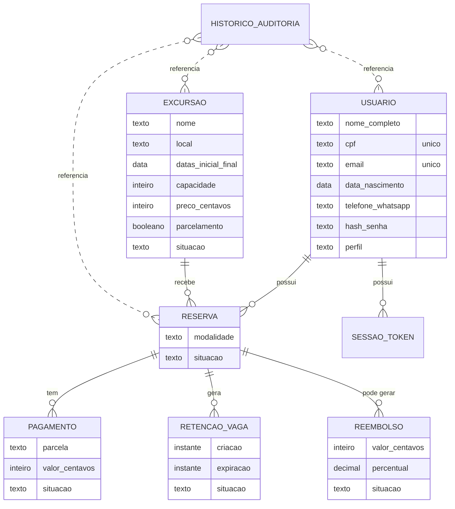
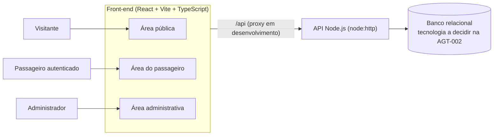
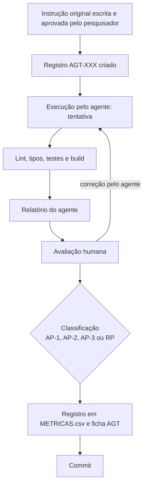
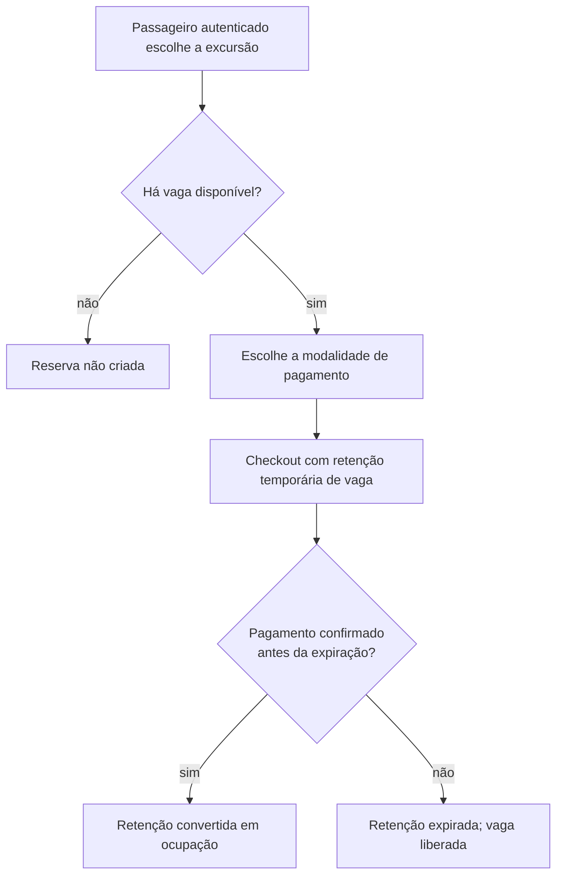
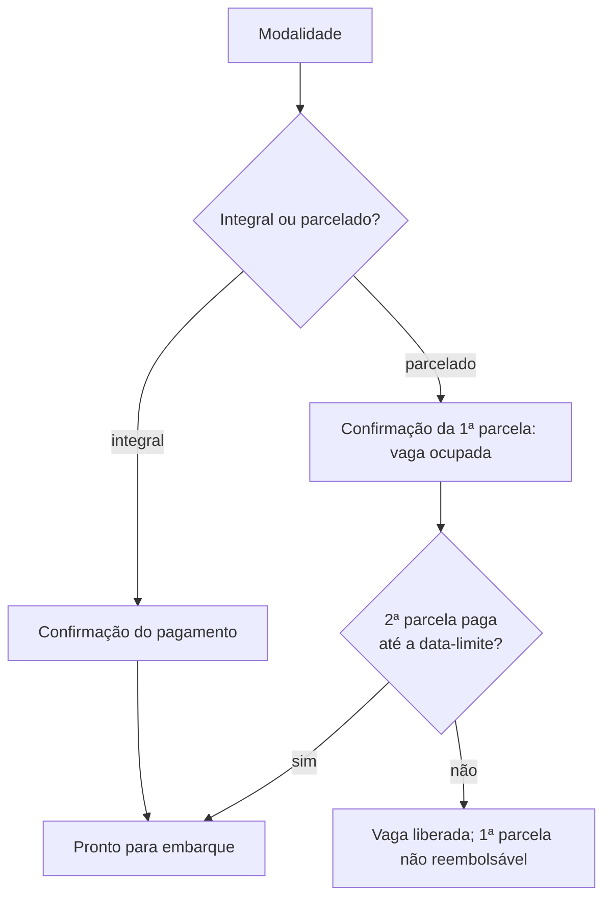
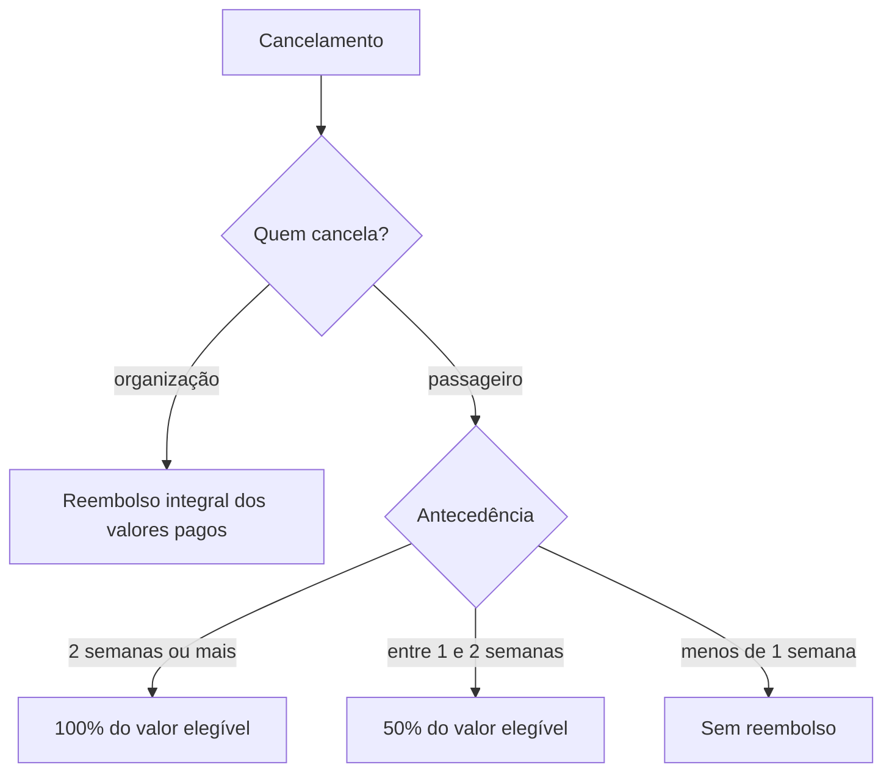

# Diagramas (Mermaid)

Todos os diagramas derivam de documentos reais do projeto. Nenhum esquema físico foi inventado:
o banco do experimento principal **ainda não existe** (AGT-002 não executada).

## 1. Modelo entidade-relacionamento **conceitual**

Fonte: `docs/especificacao/06-MODELO-DE-DADOS.md` (TCC, Seção 4.7). **É conceitual, não o esquema do
banco.** O ER do esquema real será gerado depois da AGT-002.

Restrições conceituais: ocupação nunca excede a capacidade (RN-021); valores em centavos (RN-038);
instantes em UTC (RN-039).

## 2. Arquitetura por áreas

Fonte: `docs/especificacao/01-VISAO-GERAL.md` e estado atual do código (AGT-001, `d65d64f`).

Hoje existe apenas a fundação: uma página inicial e a rota `GET /api/health`. As áreas e o banco são
atividades futuras.

## 3. Fluxo experimental

Fonte: Seção 3.5 do TCC e `TCC/MODELO-REGISTRO-AGT.md`.

## 4. Fluxos críticos (planejados)

Fonte: `docs/especificacao/05-FLUXOS-E-ESTADOS.md` e `04-REGRAS-DE-NEGOCIO.md`. Ainda **não
implementados** no experimento principal.

### 4.1 Reserva e retenção de vagas

Situações da reserva: `Aguardando pagamento` → `Pronto para embarque` → `Concluída`; `Cancelada` a
partir de qualquer situação não final.

### 4.2 Pagamento

### 4.3 Cancelamento e reembolso

Percentuais: TCC, Seção 4.5.4. A primeira parcela de reserva parcelada não quitada permanece não
reembolsável.
